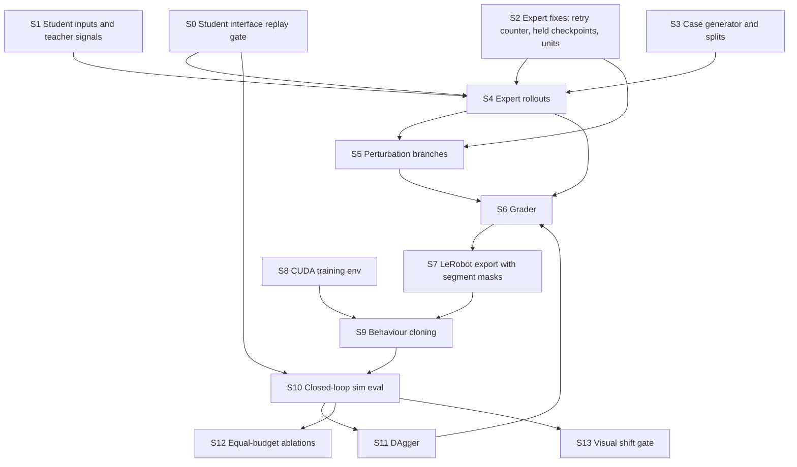

# Plan: distilling the realistic six-face agent into a VLA student

Revision 2 (2026-11-19), after an independent audit of revision 1 (commit `4fa13cc`). Paths are relative to the
repository root `E:/digital_twin_armigo`. **exists** marks code that is in the repository today; everything else is
proposed. Section 11 lists what changed from revision 1 and why.

## 0. What the auditor should check

1. Whether each step's principle is sound and its gate actually tests that principle.
2. Whether the student can receive information it would not have on a real robot, and whether the teacher acts on
   information the student cannot infer (section 6).
3. Whether the "exists" claims match the code (section 2 gives evidence and commands).
4. Whether the compute and storage numbers (section 8) follow from measurements.
5. Whether the order of work (section 10) puts the cheap decisive checks before the expensive collection.

## 1. System recap

**Task.** An SO-101 arm (joints `shoulder_pan, shoulder_lift, elbow_flex, wrist_flex, wrist_roll, gripper`) inspects a
Duplo brick (2x2; 2x4 in 20 % of layouts) for a drawn cross on any of its six faces, then places it in the pink bowl
(defective) or the green bowl (normal), or leaves it (`unknown`). Instruction: `TASK` in `agent/twin_graph.py`.

**Simulator.** MuJoCo cell (`src/digital_twin_armigo/mujoco_cell/`), 30 Hz (`constants.FPS`), joint position targets
through a command filter (`mujoco_cell/episode.py: Episode.step`). Cameras: `top` (fixed, hand-eye calibrated in
`realistic`), `wrist_cam`, `front` (fixed), and a simulated D415-like top depth image.

**Expert.** A LangGraph graph (`agent/twin_graph.py`; nodes `prepare, choose_view, scan_wrist, present_bottom,
recover, place, evaluate`) calls skills in `agent/twin_mujoco.py: TwinMujoco`. A skill is Python code that runs
motion generators frame by frame (`TwinMujoco._execute`) and, between motion segments, captures inspection images
(`TwinMujoco._capture`), scores them with the `sup-v7bot` detector and may stop early. Example, the wrist scan
(`twin_mujoco.py` around line 927): for each planned view, move and hold (the hold is labelled phase `approach`),
capture, and break out of the scan as soon as `decision(views)` says `defective`. Labels come from
`twin_graph.decision`: defective on the first view whose score passes the threshold; normal once all six faces were
covered by clear views; else unknown.

**Sensing modes** (`TwinMujoco(sensing=...)`):

- `truth` (omniscient): planners read the simulator's brick pose, bowl positions and contact forces; recovery rewinds
  physics to a checkpoint (`TwinMujoco.rewind`, `restore_state`).
- `realistic`: skills read sensors (`results/agent-bench/perception/REPORT.md`, "Sensor-only skills"): brick pose from
  noisy top depth through the calibrated camera; in-hand brick from forward kinematics times the grasp pose; bowls
  from colour plus a 3D rim fit; contact from the gripper's position, its previous command and actuator effort
  (`agent/sensing.py`); placement check from depth. Recovery from the current state (`TwinMujoco._retry`: park or let
  go, ready pose, locate the brick again). **Exception:** the grasp clearance checks still use the true bowl and
  clutter collision geometry (about 1.5 mm from the perceived bowls). The final `evaluate` is ground truth.

No planner knows the defect, its face or the true label (`inspection.assert_no_defect_leakage`; step MCP
`SIMULATOR_KEYS` guard).

**Measured expert quality.** bench16 (`config/agent_bench/bench16.json`: 8 layouts, seeds 600001-600008, each as
normal and as defective; one bottom-face defect). `realistic`: 16/16 sorted and labelled, 0 recoveries; belief error
on the table 3.0 mm median (3.4 max), in hand 4.9 (7.9), bowls 1.5 (2.6). Note: the 40 px bottom-view border was added
after a failure on 600006 in this suite (15/16 → 16/16), so bench16 is a tuned regression suite, not a test set.

## 2. Verified current state (evidence)

| Item | Finding |
|---|---|
| Episode recorder (**exists**) | `agent/twin_record.py: EpisodeTrace`. Per branch: `actions.npz` (`state` = joint reading at t; `action` = the next unfiltered target; `phase`), lossless FFV1 videos `front, wrist, top_rgb, top_depth`; `events.jsonl` with `node`, `view`, `view_truth` (scoring only: `true_face_pixels`, `belief_error_mm`), `retry`, decisions. |
| LeRobot exporter (**exists**) | `twin_record.export_lerobot` / `student_frames`: only `SUCCESS`, `student_eligible`, one branch from frame 0, `rewinds == 0`, video on. LeRobot 0.6 v3, 30 fps. Probe (2 `realistic` episodes, 2870 frames) exported and reloaded with `video_backend="pyav"`. Features: `observation.state`, `action` (6, normalized), images `front, wrist, top_full, top_rgb_v2, top_depth_v2`, one `task` string. |
| In-place recovery is **not** exportable today | `_retry` increments `self.rewinds` (`twin_mujoco.py` ~line 1162), so `student_eligible` is false even when the history is one continuous physical branch. Audit reproduction: fault injected at frame 192, in-place recovery, correct sort, result `SUCCESS, rewinds=1, student_eligible=False`. |
| Checkpoints skip held states | `TwinMujoco._save` returns early when `self.held is not None` (~line 562); no checkpoint exists while the brick is in the gripper. |
| Capture timing | bench16 `realistic` runs: 28 wrist captures at phase `approach` (hold before capture), 9 top captures at the boundary `show_hold` → `show_move`. Capture is triggered by skill code between segments, not by phase. |
| Joint units | `joints.rad_to_normalized` maps to "Studio" units documented as [-100, 100]; over 22,828 bench16 expert commands, `wrist_roll` leaves that range on 3,698 frames (16.2 %), spanning about [-178.7, 192.3]. |
| Case sampling | `sample_case(seed, positive, face)` calls `sample_layout` **without** the real-layout prior (uniform positions in reach) and then overwrites the top and front cameras with constants. 100 seeds give 100 brick positions but one camera configuration. Randomized per seed: positions, brick yaw, brick colour, 2x2/2x4, table colour/tile, light direction/level. Clutter and distractors are disabled. |
| Health scoring | `evaluate` skips `_health` when the label is `unknown`; the main collision measure excludes gripper contact with the table or bowls (`mujoco_cell/episode.py` ~line 24). |
| Throughput | One measurement: 2 episodes in 96 s with 2 workers, video on (48 s per episode overall, i.e. 96 s per episode per worker). `--smooth-for-vla` runs serially in-process and reruns eligible successes (`twin_mcp.py` ~line 796). |
| Storage | Raw about 240 MB per episode (lossless video); exported about 47 MB. 381 GB free on E:. |
| Training env | `E:/il/lerobot`: LeRobot 0.6.0 (`smolvla, pi0, pi05, act, diffusion`), CPU-only torch. A CUDA env is needed. |
| LeRobot chunk semantics | In LeRobot 0.6.0 the action chunk is clipped only at episode ends (`datasets/dataset_reader.py` ~line 219) and the task string is that of the chunk's first frame (~line 350). A 30-60 frame chunk can cross a skill boundary. |

## 3. Design decisions

### Recommended

- **R1. Teacher acts on what the student can observe.** Behaviour cloning fits p(action | observation history). If
  the teacher's action depends on state the student cannot infer, the student averages over it (imitation gap). The
  `realistic` expert is closer to this than `truth`, but it is **not yet** student-consistent: it uses noisy depth,
  the previous gripper command, effort, and true bowl geometry for clearance. S1 fixes the student's inputs first and
  then restricts the teacher to signals inferable from them (or adds them to the student).
- **R2. `truth` is grader and scenario generator, not demonstrator.** It decides which episodes enter the dataset
  (S6) and creates perturbation scenarios (S5). Whether a `truth` teacher actually hurts the student is an
  experiment (S12), not an assumption.
- **R3. Hierarchical student at the granularity of motion segments.** The graph and detector keep choosing views and
  labels. The student executes **segments**: the motion between two decision points, for example "go to inspection
  view k", "grasp and present the bottom", "carry to the pink bowl and release", "return to ready". The harness
  captures an image when a segment ends, exactly where the expert captures. Principle: inspection evidence and label
  decisions span about a minute and several views; segment boundaries are where the expert's own code waits for a
  sensor result, so no action label should depend on a future decision.
- **R4. Canonical action unit is radians**, with a documented, invertible normalization whose range covers the
  expert's joint span (the Studio [-100, 100] range does not, see section 2). The executed target goes through the
  same command filter as the expert's.
- **R5. Layout-level splits and a sealed test.** Train, validation and final test never share a layout seed;
  perturbation branches inherit their parent's split. bench16 is a regression suite only. The final test layouts are
  generated once, frozen, and never used for tuning or DAgger.

### Open (owner decides before S2)

- **D1.** Student inputs on the real rig: `front` camera present? depth? gripper effort / previous command? action
  history? (drives R1).
- **D2.** Student family: SmolVLA (about 450M), pi0 / pi0.5 with LoRA, or ACT with a skill embedding (also the
  ablation in S12).
- **D3.** Camera-pose randomization per layout (requires per-episode hand-eye calibration in `realistic`) or fixed
  cameras matching the real rig.
- **D4.** Pilot size (proposal 300 episodes) and whether to scale (gated by section 10).

## 4. Pipeline (DAG)

## 5. Steps

Each step: goal, principle, components (**exists** / **new** / **change**), gate, risks.

### S0. Student interface replay gate (first)

- **Goal.** Prove the student execution interface can reproduce an expert episode before any model is trained.
- **Principle.** If the interface cannot reproduce captures, decisions, early stops and placement from the expert's
  own actions, a failing student cannot be diagnosed.
- **Components.** **new:** `agent/student_rollout.py`:
  - A segment executor that replaces the skills' motion generators: it receives a segment instruction from the
    graph, feeds per-frame observations to a policy and applies the returned targets through `Episode.step`, until
    the policy signals `segment_done` (or a frame budget ends).
  - The graph-side logic of each skill (which segment comes next, when to capture, early stop after a defective
    view, failure checks) moves into a small controller that issues segments and calls the existing `_capture`
    after each inspection segment.
  - A `ReplayPolicy` that plays a recorded expert episode's actions and segment ends.
- **Gate.** For every bench16 `realistic` episode replayed through the interface: same capture frames (±0), same
  detector decisions, same early stops, same segment ends, same destination; final `evaluate` identical. Plus one
  episode containing an observable perturbation, a detected failure and an in-place recovery (needs S2, S5) that
  replays and exports.
- **Risk.** Some skill logic is interleaved with motion (e.g. clearance checks inside the scan loop); the controller
  must reproduce it exactly or the replay gate fails, which is the point of the gate.

### S1. Student inputs and teacher signals

- **Goal.** Fix what the student observes, then make the teacher depend only on signals inferable from it.
- **Principle.** R1. Candidate asymmetries found by the audit: noisy depth (the student gets RGB unless D1 adds depth;
  the exported depth is a separate height encoding, not the teacher's depth), previous gripper command and effort
  (contact detection), true bowl geometry in clearance checks.
- **Components.** **change:** clearance checks use the perceived bowls (`self.bowls`) with a margin, removing the last
  truth exception from `realistic`. **change:** add the chosen extra inputs to the export (e.g. gripper effort and
  previous command as state dimensions; depth as a lossless single-channel uint16 feature if kept).
- **Gate.** A written input list agreed for the real rig (D1); `realistic` bench16 still 16/16 after the clearance
  change; every teacher signal is either a student input or a deterministic function of the student's history.

### S2. Expert fixes before collection

- **Components.**
  - **change:** separate counters: `retries` (in-place, `_retry`) and `rewinds` (physics restore). `student_eligible`
    requires `rewinds == 0` only; the exporter checks the same. Episodes with retries become recovery
    demonstrations.
  - **change:** allow checkpoints while the brick is held (save the grasp pose and contact-filter state with it), so
    perturbation branches can start mid-carry.
  - **change:** canonical radians in the export plus the normalization range (R4); drop the Studio range assumption.
- **Gate.** The audit's frame-192 fault case ends `SUCCESS, rewinds=0, retries=1, student_eligible=True`; a held
  checkpoint restores to identical state; round trip rad → normalized → rad exact on all bench16 commands.

### S3. Case generator and splits

- **Principle.** Measure generalization on unseen layouts; know the real scene and skill distribution.
- **Components.** **new:** `scripts/vla/make_suites.py`: seed ranges for train / val / sealed test, class mix,
  optional real-layout prior (`sample_layout(prior=...)`), D3 camera randomization. It also **reports the realized
  distribution**: brick positions, camera parameters, and the expected skill frequencies. With the proposed mix of
  3 normal : 1 per defect face and wrist views first, the bottom presentation runs for normal bricks and face-5
  defects, i.e. 4/9 of episodes.
- **Gate.** Disjoint seeds; realized distribution matches the stated one; bench16 seeds absent.

### S4. Expert rollouts

- **Components.** **exists:** `armigo-mcp run --sensing realistic --workers N` (video unless `--headless`).
  `--smooth-for-vla` is serial; either parallelize it (batch the baseline runs, then the reruns) or skip it for the
  pilot and use segment masks (S7) against timing ambiguity. **new:** `scripts/vla/rollout_and_export.py` (batches;
  grade, export, then delete raw lossless video per batch).
- **Gate.** Expert success on the train suite ≥ 95 %; one full pilot batch timed with the final configuration
  (smoothing, video, grading, export) before any scale-up estimate is used.

### S5. Perturbation branches (recovery demonstrations)

- **Principle.** A student must see failure states with a visible cause and the recovery that follows. An abort
  without visible cause (the existing `fault` hook) is useful only to test the recovery path.
- **Components.** **new:** `TwinMujoco(perturb=...)`: displace the brick before a grasp, offset it in the jaws, drop
  it mid-carry, nudge it after a put-down. **new:** branch runner from checkpoints (needs S2 held checkpoints).
  **change:** branch exporter that concatenates the parent prefix and the branch (deterministic restore). **new:**
  loss mask on "blind" frames between the perturbation and the expert's detection.
- **Gate.** Expert recovery ≥ 80 % per perturbation type; every exported branch contains a detection event after the
  perturbation; one branch passes the S0 replay gate.

### S6. Grader

- **Principle.** Export only successes earned for the right reasons; the grader may use ground truth because it only
  filters.
- **Components.** **new:** `agent/vla_grader.py`:
  1. `student_eligible` (after S2).
  2. **Decision crop check:** the crop that triggered the label (`placement_evidence` for defective) actually shows
     the defect face and the cross (`view_truth.true_face_pixels` and the cross pixels from segmentation); for
     normal, each face was cleared by a view whose crop truly shows it. Face numbers are aligned first: the 2x2
     brick's yaw is known only modulo 90 deg, so belief face ids are mapped to true ids by the symmetry that best
     matches the brick yaw before comparison. (The audit found 12 of 37 views whose raw belief face set differs from
     the true visible set; a union over views hid this in all 16 episodes.)
  3. Belief error bounds per scored view.
  4. Collisions counted over **all** attempts, including `unknown` episodes and recoveries, and including gripper
     contact with the table and bowls; physical scoring windows from simulator events, never from a predicted phase.
  5. Smoothness within the expert's 95th percentile.
- **Gate.** Pass rate per class reported; no class below 0.8x the mean pass rate.

### S7. LeRobot export with segment masks

- **Principle.** No action label may depend on information produced after its observation (a detector result, a
  segment switch, a takeover).
- **Components.** **change:** per-frame segment id and instruction; a per-frame `chunk_valid_len` = frames until the
  next segment boundary; the training loss masks chunk steps beyond it (LeRobot pads only at episode ends, so this is
  a dataloader/loss change). Segment ends are the student's `segment_done` labels. Blind-frame masks (S5). Inputs per
  S1, units per S2.
- **Gate.** Round trip: alignment of images and actions (1 ms), no unmasked chunk step crosses a boundary, masks and
  instructions match the events.

### S8. CUDA training env

- **Components.** **new:** env with torch cu128 (Blackwell) and LeRobot 0.6.0 pinned like the export env.
- **Gate.** One training step on the probe dataset on GPU.

### S9. Behaviour cloning

- **Components.** **new:** `scripts/vla/train.py`: inputs per S1, segment instruction, action chunk (1-2 s) with the
  S7 mask, `segment_done` head. Image-space augmentation (colour, noise, crops) at training time.
- **Gate (offline).** Validation action error per segment type; `segment_done` F1 ≥ 0.9. Closed loop (S10) decides.

### S10. Closed-loop simulation evaluation

- **Components.** The S0 interface with the trained policy; policy server in the CUDA env, twin as client; at a
  segment switch the action queue is cleared. Graded by `evaluate` plus S6 rules.
- **Suites.** bench16 (regression), validation layouts, perturbation suite. The sealed test only at the end.
- **Report.** Teacher success on the same layouts, student absolute sort rate, missed defects, perturbation detection
  and recovery rates, collisions over all attempts; paired differences with per-layout confidence intervals.

### S11. DAgger

- **Principle.** Ross et al. 2011: label student-visited states with expert actions, aggregate, retrain.
- **Components.** Takeover: a gate (deviation from the `realistic` expert's plan from the same state, a detected
  failure, a stall) hands control to the expert, which recovers in place and finishes. A takeover action labels only
  the state where it was produced; it is never back-filled to earlier student frames, and the student's chunk is
  cut at the takeover (S7 mask). New episodes go through S6 and S7.
- **Gate.** Stop when two iterations add < 2 points on validation layouts.

### S12. Equal-budget ablations

- **Question.** With equal demonstration budget, does a teacher acting on student-observable signals, plus recovery
  demonstrations with visible causes, raise closed-loop success on new layouts and under perturbations?
- **Design.** 2x2: teacher (`truth` vs `realistic`, after S1) x data (plain vs plus S5 branches); same student, same
  segment instructions, same layouts and training budget. Second axis: ACT with a segment-id embedding vs SmolVLA,
  to measure what the pretrained vision-language backbone contributes. Report the S10 metrics on the sealed test.
- **Scope of claims.** The hierarchical student supports the claim "a segment-conditioned motor policy can run the
  inspection workflow". Claims about language understanding, cross-view reasoning or autonomous inspection need
  experiments that isolate them.

### S13. Visual shift gate

- **Components.** **change:** an Isaac render profile for the student cameras at native intrinsics; fix the
  one-frame annotator lag (`app.update()` before reading). **new:** open-loop action error on the same held-out
  trajectories rendered by MuJoCo and RTX.
- **Gate.** RTX error ≤ 1.5x MuJoCo error per segment type. Can reject, not approve; real closed loop is untested.

## 6. Information rules

- Student inputs: the S1 list only.
- Segment instructions come from the graph, which runs on detector scores of real images and `realistic` beliefs.
- Ground truth is used only for grading (S6), choosing perturbations (S5) and evaluation (S10-S12). Takeover gates
  use the `realistic` expert's plan, not true poses.
- Filtering by ground truth can bias the dataset; S6 reports per-class pass rates.

## 7. Gates (summary)

| Step | Gate |
|---|---|
| S0 | bench16 replay identical in captures, decisions, stops, segment ends, destination; one recovery episode replays and exports |
| S1 | input list agreed; `realistic` 16/16 without the truth clearance exception |
| S2 | frame-192 fault case eligible; held checkpoint exact; unit round trip exact |
| S3 | disjoint seeds; realized distribution reported |
| S4 | expert ≥ 95 % on train; pilot batch timed |
| S5 | expert recovery ≥ 80 % per perturbation; detection event present |
| S6 | per-class pass rate ≥ 0.8x mean |
| S7 | no unmasked chunk step crosses a boundary |
| S9 | `segment_done` F1 ≥ 0.9 |
| S10 | pilot student ≥ 0.7x teacher, then ≥ 0.9x; 0 collisions over all attempts |
| S11 | stop below 2 points per two iterations |
| S13 | RTX ≤ 1.5x MuJoCo action error |

## 8. Compute and storage

- Rollouts: one measurement only (48 s per episode overall with 2 workers). Linear extrapolation to 8 workers gives
  about 6.7 h for 2000 episodes without smoothing; with serial smoothing much more. Use the S4 pilot timing instead.
- Storage: exported about 47 MB per episode (2000 about 94 GB); raw 240 MB per episode deleted per batch.
- GPU shared with the local vLLM servers and Isaac rendering; schedule them apart.

## 9. Risks

| Risk | Mitigation |
|---|---|
| Interface cannot reproduce expert | S0 before any training |
| Labels depending on future decisions | segment granularity (R3), chunk masks (S7), queue reset (S10) |
| Teacher-student information asymmetry | S1 |
| Recovery data rejected by the exporter | S2 counters |
| Grader blind to symmetric face ids or gripper collisions | S6 rules 2 and 4 |
| Overfitting to bench16 | sealed test (R5) |
| Unit range breaking wrist roll on hardware | R4 before collection |
| Optimistic schedule | S4 pilot timing |

## 10. Order of work and scale-up rule

1. S0 with `ReplayPolicy` on bench16; S1 decisions; S2 fixes. No collection before these pass.
2. S3, then a 300-episode pilot through S4, S6, S7; S8.
3. S9 and S10 on the pilot (first student numbers on validation layouts).
4. S5 branches, S11 DAgger, S12 ablations at pilot scale.
5. Scale to about 2000 episodes only if the pilot student reaches ≥ 0.7x the teacher on validation layouts and the
   S12 results say which data to collect. Then S13 and the sealed test.

## 11. Changes from revision 1 (audit findings)

| Revision 1 claim or plan | Finding | Change |
|---|---|---|
| Capture when the predicted phase is `show_hold` | All 28 wrist captures happen at `approach`; captures are triggered by skill code between segments; scans stop early | Segment-level student (R3), S0 replay gate first |
| In-place recoveries stay exportable | `_retry` increments `rewinds`; exporter rejects; no checkpoints while holding | S2 counters and held checkpoints |
| Per-frame skill task strings are enough | LeRobot chunks cross skill boundaries; task taken from the chunk's first frame | S7 masks, queue reset, takeover labels not back-filled |
| `realistic` expert is student-consistent | Uses noisy depth, gripper command and effort, true bowl geometry | S1 before collection |
| Camera poses randomized; prior positions; 1/3 bottom | `sample_case` fixes both cameras and uses no prior; the mix gives 4/9 bottom | S3 reports the realized distribution; D3 |
| Grader: union of cleared faces; health from `evaluate` | Symmetric face ids differ in 12/37 views; union hides it; `unknown` skips health; gripper-table/bowl contact excluded | S6 rules 2 and 4 |
| 3.5 h for 2000 episodes | One sample; 6.7 h linear at 8 workers; smoothing serial | S4 pilot timing |
| Normalized Studio units | `wrist_roll` outside [-100, 100] on 16.2 % of frames | R4 radians canonical |
| bench16 as test | Tuned on 600006; 8 layouts, one bottom defect | R5 sealed test; S12 ablations |
