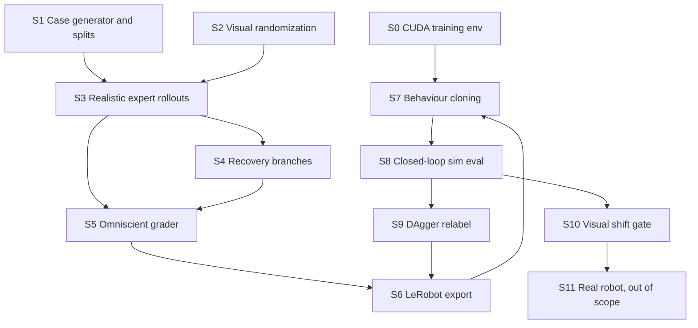

# Plan: distilling the realistic six-face agent into a VLA student

Status: proposal for independent audit (2026-11-19). Nothing below step S0 has been built unless marked
**exists**. Paths are relative to the repository root `E:/digital_twin_armigo`.

## 0. What the auditor should check

1. Whether each step's principle is sound and its acceptance gate actually tests that principle.
2. Whether the student can ever receive information it would not have on a real robot (section 6).
3. Whether the "exists" claims match the code (section 2 lists the evidence and the commands).
4. Whether the data, compute and storage numbers (section 8) are plausible.
5. Whether the order of the steps and the open decisions (section 3) are right.

## 1. System recap

**Task.** An SO-101 arm (6 joints: `shoulder_pan, shoulder_lift, elbow_flex, wrist_flex, wrist_roll, gripper`)
inspects a Duplo brick (2x2, 20 % of layouts 2x4) for a drawn cross on any of its six faces, then places it in the pink
bowl (defective) or the green bowl (normal), or leaves it (`unknown`). Instruction string: `TASK` in
`src/digital_twin_armigo/agent/twin_graph.py`.

**Simulator.** MuJoCo cell (`src/digital_twin_armigo/mujoco_cell/`), 30 Hz control (`constants.FPS`), joint position
targets passed through a command filter (`mujoco_cell/episode.py: Episode.step`). Cameras: `top` (fixed, calibrated
by hand-eye), `wrist_cam` (on the gripper), `front` (fixed, external), plus a simulated D415-like top depth image.

**Agent (the expert).** A LangGraph graph (`agent/twin_graph.py`, nodes
`prepare, choose_view, scan_wrist, present_bottom, recover, place, evaluate`) drives skills implemented in
`agent/twin_mujoco.py: TwinMujoco`. Skills are scripted planners (Python generators consumed frame by frame in
`TwinMujoco._execute`). A supervised two-head LoRA detector (`sup-v7bot`, spec
`results/agent-bench/sup-v7bot-local.json`) scores each inspection view for a cross. The graph clears faces from
scored views and chooses the label from the evidence.

**Sensing modes** (`TwinMujoco(sensing=...)`):

- `truth` ("omniscient"): planners read the simulator's brick pose, bowl positions, contact forces; recovery rewinds
  physics to a checkpoint (`TwinMujoco.rewind`, `restore_state`).
- `realistic`: skills read only sensors (details: `results/agent-bench/perception/REPORT.md`, section
  "Sensor-only skills"). Brick pose from top depth through the calibrated camera; in-hand brick from forward
  kinematics times the grasp pose; bowls from colour plus a 3D rim fit; contact from gripper position/effort
  (`agent/sensing.py`); placement check from depth against an empty-bowl baseline; recovery from the current state
  (`TwinMujoco._retry`: park or let go, ready pose, locate the brick again). The final `evaluate` is ground truth.

Neither mode's planners know the defect, its face or the true label (`inspection.assert_no_defect_leakage`, step MCP
`SIMULATOR_KEYS` guard).

**Measured expert quality (bench16, `config/agent_bench/bench16.json`, seeds 600001-600008 x {normal, defect}).**
`realistic`: 16/16 sorted, 16/16 labels, 0 recoveries; brick belief error on the table 3.0 mm median / 3.4 max, in
hand 4.9 / 7.9 mm; bowls 1.5 / 2.6 mm. `truth`: 16/16.

## 2. Verified current state (evidence)

Probe run on 2026-11-19 (outputs in the session scratchpad, not in git):

    armigo-mcp run --sensing realistic --detector results/agent-bench/sup-v7bot-local.json --workers 2 \
      --suite <[[600001,true,0],[600002,false,5]]> --out <probe>/runs          # video on (no --headless)
    PYTHONPATH=src E:/il/lerobot/Scripts/python.exe -m digital_twin_armigo.agent.twin_record \
      --out <probe>/dataset <probe>/runs/case-0000 <probe>/runs/case-0001

Results:

| Item | Finding |
|---|---|
| Episode recorder (**exists**) | `agent/twin_record.py: EpisodeTrace`. Per branch: `actions.npz` (`state` = joint reading at t, `action` = the next unfiltered joint target, `phase`), lossless FFV1 streams `front, wrist, top_rgb, top_depth`. Video sample i is what the policy saw before command i. Events (`events.jsonl`): `node`, `view`, `view_truth` (scoring only: `true_face_pixels`, `belief_error_mm`), decisions. |
| LeRobot exporter (**exists**) | `twin_record.export_lerobot` / `student_frames`. Accepts only `SUCCESS`, `student_eligible`, single branch from frame 0, no rewinds, video on. Writes LeRobot 0.6 v3 dataset, `robot_type=SO101_Follower`, 30 fps. |
| Exported features | `observation.state` (6, normalized), `action` (6, normalized), `observation.images.{front, wrist, top_full, top_rgb_v2, top_depth_v2}`, `task` (single string). Loaded back with `LeRobotDataset(..., video_backend="pyav")`: 2 episodes, 2870 frames. |
| Eligibility under `realistic` | Both probe episodes `student_eligible=True`, 0 rewinds, 1 branch. `realistic` recoveries do not rewind, so episodes with recoveries remain exportable. |
| Throughput | 2 episodes (1035 and 1835 frames) in 96 s wall with 2 workers, video on, about 48 s per episode per worker. Machine: 32 logical CPUs, one RTX 5090 (32 GB). |
| Storage | Raw trace about 240 MB per episode (lossless video). Exported LeRobot about 47 MB per episode (AV1 video). E: has 381 GB free. |
| Provenance gap (fixed, commit `2229ebf`) | `episode.json` provenance now records `sensing`. |
| Remaining export gaps | No per-frame skill/phase feature exported (phase is in `actions.npz`, skill node in events). Depth is a 3-channel uint8 height encoding (`depth.layered_height_image`) and is then lossy-compressed. `observation.state` is the exact joint reading (no sensor noise). |
| Training environment | `E:/il/lerobot` has LeRobot 0.6.0 with `smolvla, pi0, pi05, act, diffusion` policies, but **CPU-only torch 2.11**. A CUDA (cu128, Blackwell) environment is required (S0). |
| Scene randomization (**exists**) | `mujoco_cell/layout.py: sample_layout`: bowl and brick positions (from a prior of real arrangements plus noise), brick yaw, brick colour, 2x2 vs 2x4, table colour and tile size, light direction and level, top camera pose noise (1 cm, 1-2 deg, focal ±2 %), front camera pose. `agent/twin_mujoco.py: sample_case(seed, positive, face)` makes a case from any 32-bit seed; it disables clutter and distractors. |
| Failure injection (**exists**) | `TwinMujoco(fault=callable)`: called each frame with `(node, branch, frame)`; returning true aborts the running skill with `INJECTED_MOTION_FAILURE`, which the graph routes to `recover`. It is not exposed through MCP. |
| Carry smoothing (**exists**) | `armigo-mcp run --smooth-for-vla` reruns successful episodes with continuous joint-space timing on long carries and accepts the rerun only if it passes the same evaluator (docs/ARMIGO_AGENT.md, "Continuous carry demonstrations"). |
| RTX replay (**exists**) | `scripts/isaac/catalog_render.py` (Isaac Sim 6.2 PathTracing) renders recorded poses offline, about 1 s per 720p frame at 32 spp. Known issue: the annotator read after `rep.orchestrator.step` returns the previous frame (one-frame lag). |

## 3. Design decisions

### Recommended

- **R1. The demonstrator is the `realistic` expert.** Principle: behaviour cloning fits p(action | observation). If
  the demonstrator's actions depend on state the student cannot infer from its observations (privileged expert),
  the student must average over that hidden state and learns a blurred policy (the "imitation gap"). The
  `realistic` expert acts on beliefs computed from the same camera images and joint readings the student gets, so
  its actions are, in principle, a function of the student's observation history.
- **R2. The omniscient (`truth`) side is grader, filter and branch generator, not demonstrator.** It knows the true
  geometry, so it can tell a good demonstration from a lucky one (S5), and its physics checkpoints let us branch
  many recovery scenarios from one episode (S4).
- **R3. Hierarchical student.** The VLA learns the motor skills conditioned on a per-skill instruction; the
  existing graph plus detector keep choosing views and the label. Principle: the label depends on detector
  evidence gathered up to about a minute earlier, across several views; a short-context visuomotor policy cannot
  carry that memory reliably, and the decision layer is already sensor-only and 16/16. End-to-end distillation
  can follow once the motor student works (S7, variant B).
- **R4. Action space unchanged:** absolute joint position targets, normalized (`joints.rad_to_normalized`),
  predicted in chunks, executed through the same command filter as the expert. The label is the unfiltered target,
  so student and expert see identical downstream dynamics.
- **R5. Splits by seed.** Training, validation and test cases never share a layout seed. bench16 seeds
  (600001-600008) are test only.

### Open (owner decides; the plan notes where each matters)

- **D1.** Hierarchical (R3) or end-to-end first.
- **D2.** Student family: SmolVLA (about 450M, fits local fine-tuning), pi0 / pi0.5 with LoRA, or ACT (no
  language; one model per skill or a skill embedding).
- **D3.** Is there a `front` camera on the real rig? If not, drop `observation.images.front` from student inputs.
- **D4.** Pilot size (proposal: 300 episodes) and full size (proposal: about 2000 episodes plus recovery branches).
- **D5.** Whether to add joint-reading noise and depth to student inputs.
- **D6.** Takeover DAgger only, or also per-state relabelling (S9).

## 4. Pipeline (DAG)

## 5. Steps

Each step lists its goal, the principle, engineering components (**exists** / **new** / **change**), inputs and
outputs, the acceptance gate, and risks.

### S0. CUDA training environment

- **Goal.** Train LeRobot policies on the RTX 5090.
- **Principle.** The existing `E:/il/lerobot` env has CPU torch; Blackwell (sm_120) needs a cu128+ build.
- **Components.** **new:** env (e.g. `E:/il/lerobot-cu`, Python 3.12) with torch cu128, `lerobot[smolvla]==0.6.*`
  (and `pi0` extras if D2 chooses it), PyAV. Reuse `E:/venvs/armigo-anomaly` as a reference (torch cu128 works
  there). The GPU is shared with the local vLLM servers; training requires them stopped.
- **Gate.** `torch.cuda.is_available()`; one SmolVLA training step on the probe dataset; dataset loads with
  `video_backend="pyav"`.
- **Risk.** Version skew between the export env (LeRobot 0.6 CPU) and the training env; pin both to 0.6.0.

### S1. Case generator and splits

- **Goal.** Thousands of distinct, class-balanced cases with seed-disjoint splits.
- **Principle.** Generalization is measured on layouts never seen in training; balance across the 7 classes
  (normal, defect on face 0-5) so the decision layer and the bottom-presentation skill get enough data; the
  bottom skill only runs when faces 0-4 are clear, i.e. for normal bricks and face-5 defects.
- **Components.** **exists:** `sample_case(seed, positive, face)`, suite JSON format `[[seed, positive, face], ...]`.
  **new:** `scripts/vla/make_suites.py`: draws seeds from disjoint ranges (train, val, test-heldout), writes
  `config/vla/{train,val,test}.json` with a fixed class mix (proposal: 3 normal : 1 per defect face, so about 1/3 of
  episodes include the bottom skill), records the generator seed. bench16 stays a separate test suite.
- **Outputs.** Suite files under version control.
- **Gate.** No seed in two splits; bench16 seeds absent from train/val; class counts as specified.
- **Risk.** The layout prior comes from real arrangements; positions outside it are rare. Keep a uniform-position
  slice (sample_layout without prior) in val to see extrapolation.

### S2. Visual randomization

- **Goal.** Student robust to lighting, colours and small camera shifts.
- **Principle.** Domain randomization widens the training image distribution so the real (or RTX) distribution
  falls inside it. Already randomized per layout: light direction/level, table colour/tile, brick colour, top and
  front camera pose. Not randomized: textures/materials of the robot and bowls, wrist camera mounting, image noise,
  white balance, motion blur.
- **Components.** **exists:** `sample_layout`. **change (small):** optional image-space augmentation at training
  time (colour jitter, noise, small crops) in the S7 dataloader rather than in simulation, so one rollout serves
  many augmentations. **new (optional):** wrist-camera mount jitter in the cell (±2 mm, ±1 deg), applied per episode.
- **Gate.** The expert still sorts 16/16 on bench16 with any simulation-side change (randomization must not break
  perception or the detector).
- **Risk.** The detector was trained on particular renders; simulation-side randomization can lower its scores.
  Image-space augmentation affects only the student.

### S3. Realistic expert rollouts

- **Goal.** The base demonstration set.
- **Principle.** R1. Run the unchanged expert on every training case with video recording.
- **Components.** **exists:** `armigo-mcp run --sensing realistic --workers N --suite ... --out ...` (video unless
  `--headless`); optionally `--smooth-for-vla` (recommended: stop-and-go timing creates identical observations with
  different actions, which is hard for BC). **new:** `scripts/vla/rollout_and_export.py` wrapper: runs suites in
  batches, calls S5 and S6 per batch, deletes raw lossless videos of exported episodes, keeps `episode.json`,
  `events.jsonl`, `actions.npz`, keyframes (small) for audit.
- **Outputs.** Run folders with `episode.json` (provenance includes `sensing`), events, actions, videos.
- **Gate.** Expert success rate on the train suite ≥ 95 % (bench16 is 100 %); failures are kept for analysis,
  not exported.
- **Budget.** About 48 s per episode per worker; 8 workers (32 CPUs, MuJoCo rendering on the GPU) gives about
  2000 episodes in 3.5 h. Raw 240 MB per episode must be deleted after export (see section 8).

### S4. Recovery branches

- **Goal.** Demonstrations of recovering from failures the base expert rarely meets (it made 0 recoveries on
  bench16, so the base set has almost no recovery data).
- **Principle.** A student that never saw a failure state cannot recover from one. Recovery demonstrations must
  start from a visible cause: a student cannot learn to react to an abort with no visible reason. Branching from a
  checkpoint (omniscient physics restore) gives many recovery scenarios per base episode without rerunning the
  prefix.
- **Components.**
  - **exists:** checkpoints (`EpisodeTrace.checkpoint`, `TwinMujoco.restore_state`), `realistic` recovery
    (`_retry`), `fault` hook (aborts a skill; useful only to test the recovery path, see risk).
  - **new:** `TwinMujoco(perturb=callable)` hook applying a physical perturbation at a chosen frame and node:
    displace or rotate the brick on the table before a grasp; offset it in the jaws (grasp slip); release it
    mid-carry (drop); nudge it after a put-down. The realistic expert must notice the result through its own
    sensing (gripper contact, re-localization, placement check) and recover.
  - **new:** branch runner: from a successful base episode, restore checkpoint k, apply a perturbation, continue
    in `realistic` mode to the end.
  - **change:** exporter mode that writes a branch as one LeRobot episode by concatenating the parent's frames
    `[0, checkpoint_frame)` with the branch frames (restoring a checkpoint is deterministic, so the prefix is
    exact). The current exporter rejects multi-branch episodes by design (rewound histories can depend on
    information the student never had); the branch exporter is allowed because the branch is one continuous
    physical history with no rewind after the perturbation.
  - **new:** loss mask for "blind" frames, from the perturbation until the expert's sensing first detects it (the
    expert keeps executing the old plan there; those actions are wrong for the new state).
- **Gate.** Recovery success ≥ 80 % per perturbation type in the expert itself; every exported branch has a
  detection event (failure or relocalization) after the perturbation.
- **Risk.** Using `fault` alone produces recoveries with no visible cause; do not export them as demonstrations.
  A checkpoint restore in `realistic` mode must reset the belief (it does: `restore_state` resets it) and the
  gripper-contact filter state (check).

### S5. Omniscient grader

- **Goal.** Export only episodes that succeeded for the right reasons.
- **Principle.** A success can be lucky: the label is right while the evidence did not support it, or the arm
  barely missed a collision. Cloning such episodes teaches the student the same habits. The grader may use ground
  truth because it only decides which episodes enter the dataset; it never produces student inputs.
- **Components.** **exists:** `evaluate()` result (`verdict`, `label_correct`, `health`, `smoothness`,
  `student_eligible`, `placement_evidence`, `cleared_faces`), `view_truth` events (`true_face_pixels`,
  `belief_error_mm`), `audit.private.json` (true label/face). **new:** `agent/vla_grader.py` with rules:
  1. `student_eligible` (existing: success, health `SUCCESS`, no rewinds).
  2. Evidence was real: every face in `cleared_faces` had, in some scored view, at least as many true pixels
     (`view_truth.true_face_pixels`) as the per-camera threshold the twin applies when it lists a view's `faces`
     from the believed brick (in `realistic` the list comes from the belief, so it can differ from the truth); for a
     defective label, the `placement_evidence` view had the true defect face visible. Auditor: confirm the
     threshold's location in `TwinMujoco._capture`.
  3. Belief error within bounds at every scored view (proposal: ≤ 10 mm on table, ≤ 15 mm in hand).
  4. Smoothness within the expert's 95th percentile (jerk, clipped frames).
  5. Writes `grade.json` per episode (pass/fail and the reason); the exporter refuses ungraded episodes.
- **Gate.** Pass rate reported per class; if one class loses much more than the others (selection bias), adjust
  thresholds or fix the expert rather than accept an unbalanced set.
- **Risk.** Over-filtering removes exactly the hard cases the student needs; report what is removed.

### S6. LeRobot export

- **Goal.** A training dataset with skill conditioning.
- **Principle.** The hierarchical student (R3) needs to know which skill it is executing and when the skill is
  complete; the observation must be what the real robot will provide.
- **Components.** **exists:** `export_lerobot`. **change:**
  - per-frame `skill` (from `node` events: `prepare, scan_wrist, present_bottom, place, recover`) mapped to an
    instruction string per segment, e.g. "scan the brick's side and top faces with the wrist camera",
    "pick up the brick and show its bottom to the top camera", "place the brick in the pink bowl",
    "place the brick in the green bowl", "recover: release the brick and return to the ready pose"; stored as the
    LeRobot `task` per frame (LeRobot supports per-frame tasks).
  - per-frame `phase` (from `actions.npz`) as an auxiliary label, and `capture` flag on frames where the expert
    captured an inspection image (from `view` events).
  - `sensing` and `grade` checked before export.
  - D3: drop `front` if the rig lacks it. D5: optional joint noise; depth as a single-channel uint16 image feature
    (lossless) instead of lossy 3-channel video, if depth is kept as input.
  - branch export (S4) and the blind-frame mask.
- **Gate.** Round trip: re-read dataset, check frame count, per-frame alignment of images and actions (the
  existing exporter checks timestamps to 1 ms), task strings, masks.

### S7. Behaviour cloning

- **Goal.** A motor policy π(action chunk | images, joint state, skill instruction).
- **Principle.** Supervised regression on expert chunks. Chunking (ACT-style, 1-2 s at 30 Hz) reduces compounding
  error and handles pauses; the auxiliary phase head gives the harness a signal for capture and completion.
- **Components.** **new:** `scripts/vla/train.py` (LeRobot training config): inputs `wrist`, `top_full`
  (and `front` per D3), `observation.state`, task string; outputs 6-D joint chunk; auxiliary heads `phase`
  (classification) and `skill_done` (binary, last 10 frames of a segment), added to the policy or as a small
  separate head on the same features. Image augmentation per S2. Variant B (end-to-end, D1): single `TASK`
  instruction with observation history (inspection keyframes as extra image tokens) so the label can depend on
  earlier views.
- **Gate (offline).** Validation action error per skill; phase accuracy ≥ 95 %; `skill_done` F1 ≥ 0.9.
  Offline numbers do not prove closed-loop success; S8 decides.
- **Risk.** SmolVLA/pi0 do not have auxiliary heads natively; adding them is a model change. ACT has no language,
  so skills need a learned embedding.

### S8. Closed-loop simulation evaluation

- **Goal.** Measure the student acting in the twin, graded exactly like the expert.
- **Principle.** Only closed-loop rollouts expose covariate shift (small errors moving the student into states the
  expert never visited). The high level stays the existing graph and detector; the student replaces the skill
  executors.
- **Components.**
  - **new:** `agent/student_rollout.py`: a `StudentExpert` object implementing the interface `_execute` already
    consumes (`act(obs) -> (target, phase)`, `done`), returning targets from the policy's current chunk;
    `done` from `skill_done`. Rendering the student's cameras every frame (`cell.rgb("wrist_cam")`,
    `cell.rgb("top")`, `cell.rgb("front")`).
  - Inspection capture: when the predicted phase is `show_hold` and the arm is still, the harness calls the
    existing realistic capture path, so the detector sees the same crops as in expert episodes.
  - **new:** policy server in the CUDA env (the twin runs in the Python 3.14 `.venv` without torch): a local socket
    or LeRobot's async inference server; the twin is the client. Inference every k frames (chunk execution with
    temporal ensembling).
  - Grading with the existing `evaluate()` and the S5 rules; reports per skill.
- **Suites.** bench16 (test), `config/vla/test.json` (held-out seeds), perturbation suite (S4 perturbations
  applied to the student).
- **Gate.** Student sorting success vs expert on the same cases (proposal: pilot ≥ 70 %, final ≥ 90 % of the
  expert's rate); zero `health` failures of type collision; recovery success under perturbations reported.
- **Risk.** Rendering three cameras per frame costs about 3x the expert's rendering; acceptable at evaluation
  scale. The latency of the policy server is irrelevant in simulation (the sim waits) but must be measured for
  the real robot.

### S9. DAgger relabelling

- **Goal.** Close the covariate shift loop.
- **Principle.** DAgger (Ross et al. 2011): run the student, label the states it visits with the expert's
  actions, aggregate, retrain. The expert must be able to act from student-visited states.
- **Components.**
  - **Takeover DAgger (first, D6):** in S8 rollouts, a gate triggers when the student deviates (joint-space
    distance to the expert's plan from the same state beyond a threshold, a detected failure, or a stall). The
    `realistic` expert takes over from the current state (its normal recovery path, then the skill) and its frames
    become new demonstrations; the student frames before the takeover are kept as observations with the expert's
    takeover actions as labels only for the first chunk (HG-DAgger style).
  - **Per-state relabelling (optional):** checkpoint the simulation at student-visited frames; offline, restore
    each checkpoint and run the expert's skill planner from that state for one chunk; the first chunk is the
    label. Valid only for phases whose planners can start mid-motion (`approach`, `show_move`, transport in
    `place`); not for mid-grasp states.
  - Aggregation: new episodes go through S5 grading and S6 export into `dagger-iter-k`; train on the union.
- **Gate.** Closed-loop success rises over iterations; stop when two iterations add < 2 points.
- **Risk.** Expert replans can include "go to ready and re-perceive", which is a different behaviour from a
  local correction; label only the first chunk. Relabelling from omniscient state would reintroduce the
  privileged-expert gap (R1); use `realistic` beliefs, recomputed from the restored state's images.

### S10. Visual shift gate

- **Goal.** Estimate how much the student depends on MuJoCo's rendering.
- **Principle.** A student that only works on the renderer it was trained on will fail on a real camera.
  Closed-loop control in Isaac is not available (offline RTX replay only, about 1 s per frame), so the test is
  open-loop: the same held-out expert trajectories rendered by MuJoCo and by Isaac RTX, the student's action error
  on each.
- **Components.** **exists:** `scripts/isaac/catalog_render.py`, `scripts/render_agent_demo.py`. **change:** a
  render profile that outputs the student's cameras (`wrist`, `top`, `front`) at native resolution and
  intrinsics instead of the hero view plus insets; fix the one-frame annotator lag (call `app.update()` before
  reading) since per-frame alignment matters here. **new:** `scripts/vla/open_loop_eval.py`.
- **Gate.** RTX action error ≤ 1.5x the MuJoCo error per skill (threshold to be agreed); phase accuracy drop
  ≤ 5 points.
- **Risk.** Open-loop error is a weak proxy for closed-loop success; this gate can reject but not approve.

### S11. Real robot (out of scope here)

Prerequisites: a hardware adapter (LeRobot `SO101_Follower` driver, camera drivers, the same normalization),
hand-eye calibration of the real top camera, the decisions D3/D5, recalibrated sensing thresholds
(`agent/sensing.py`, `perception.py`), and a safety layer (joint limits, speed limits, workspace bounds, e-stop).

## 6. Information rules (no privileged input to the student)

- Student inputs: camera images (`wrist`, `top`, optionally `front` and depth), joint readings, the skill
  instruction. Nothing else.
- The skill instruction comes from the graph, which runs on detector scores of real images and the `realistic`
  belief: sensor-only.
- Ground truth (true poses, `view_truth`, `audit.private.json`, health telemetry) is used only by S5 (filter),
  S4 (choosing perturbations) and S8/S9 (grading, takeover gates). Takeover gates use the expert's plan from
  `realistic` beliefs, not true poses, so the takeover policy does not encode privileged state.
- Selection effects: filtering by ground truth can still bias the dataset (section S5 gate).

## 7. Metrics and gates (summary)

| Step | Metric | Proposed gate |
|---|---|---|
| S1 | seed overlap, class mix | none / exact |
| S3 | expert success on train suite | ≥ 95 % |
| S4 | expert recovery success per perturbation | ≥ 80 % |
| S5 | pass rate per class | reported; no class below 0.8x the mean |
| S7 | phase accuracy, `skill_done` F1 | ≥ 95 %, ≥ 0.9 |
| S8 | student success / expert success, collisions | pilot ≥ 0.7, final ≥ 0.9; 0 collisions |
| S9 | success gain per iteration | stop below 2 points |
| S10 | RTX / MuJoCo action error | ≤ 1.5x |

## 8. Compute and storage

- Rollouts: about 48 s per episode per worker with video; 8 workers, 2000 episodes about 3.5 h. Recovery
  branches are shorter (only the suffix is simulated).
- Storage: raw 240 MB per episode, deleted after export; exported about 47 MB per episode, 2000 episodes about
  95 GB. 381 GB free on E:.
- Training: SmolVLA fine-tuning fits on one 32 GB GPU; time per epoch to be measured in S0 on the pilot.
- The GPU is shared with the local vLLM servers and Isaac rendering; schedule them apart.

## 9. Risks

| Risk | Mitigation |
|---|---|
| Imitation gap from privileged labels | R1; relabel with `realistic` beliefs only (S9) |
| Stop-and-go timing ambiguity | `--smooth-for-vla`, action chunks, phase head |
| No recovery data in base set | S4 branches with visible causes, blind-frame mask |
| Lucky successes | S5 grader |
| Detector/renderer coupling | image-space augmentation; S10 |
| Skill completion and capture timing | `skill_done` and `phase` heads (S7), harness rules (S8) |
| Expert takeover not local | label only the first chunk (S9) |
| Storage blow-up | delete raw videos per batch (S3) |

## 10. Order of work

1. S0, S1, S6 changes (skill/phase/capture fields), pilot of 300 episodes through S3, S5, S6.
2. S7 on the pilot, S8 harness; first closed-loop numbers on bench16.
3. S4 recovery branches and S9 takeover DAgger.
4. Scale to the full set, S10, then decide on S11.
