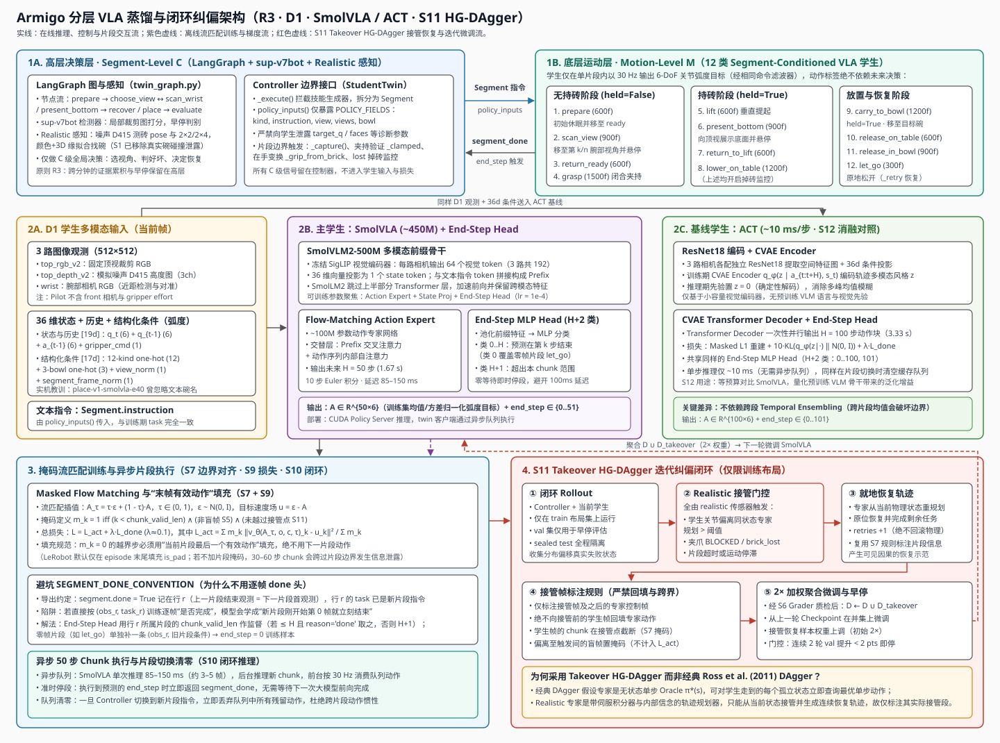

# Armigo 分层 VLA、ACT 与 HG-DAgger 深度学习指南



**模块详图**

- 在线质检与运动控制：[任务决策](./vla_task_decision.svg) · [策略观测](./vla_observations.svg) · [动作策略](./vla_policy_models.svg) · [片段执行](./vla_segment_execution.svg)
- 离线策略训练与迭代：[模仿训练](./vla_imitation_training.svg) · [专家接管与数据聚合](./vla_expert_takeover.svg)

> 本文档面向 Armigo 项目的算法研发与工程学习，系统拆解 **分层 VLA 蒸馏架构（R3 / D1 / SmolVLA）**、**ACT（Action Chunking with Transformers）** 以及 **Takeover HG-DAgger（S11）** 的数学原理、工程直觉与仓库代码映射。文中所有符号与路径均对应当前仓库（`docs/VLA_DISTILLATION_PLAN.md`、`docs/vla/STUDENT_INPUTS.md`、`src/digital_twin_armigo/agent/student_rollout.py` 与 `twin_record.py`）。

---

## 目录

1. [Armigo 分层 VLA 架构全解析](#1-armigo-分层-vla-架构全解析)
   - [1.1 为什么选 R3 分层片段（Segment），而不是端到端整条轨迹？](#11-为什么选-r3-分层片段segment而不是端到端整条轨迹)
   - [1.2 为什么 36 维结构化条件向量是强制的（D1 与实机教训）？](#12-为什么-36-维结构化条件向量是强制的d1-与实机教训)
   - [1.3 End-Step MLP Head（H+2 类）如何解决推理延迟与 `SEGMENT_DONE_CONVENTION` 命名陷阱？](#13-end-step-mlp-headh2-类如何解决推理延迟与-segment_done_convention-命名陷阱)
   - [1.4 SmolVLA 骨干与 Masked Flow Matching 数学全推导](#14-smolvla-骨干与-masked-flow-matching-数学全推导)
   - [1.5 异步 50 步执行队列与片段切换清零（S10）](#15-异步-50-步执行队列与片段切换清零s10)
2. [ACT（Action Chunking with Transformers）原理解析](#2-actaction-chunking-with-transformers原理解析)
   - [2.1 为什么单步 BC 会失败：误差累积与多模态动作平均化](#21-为什么单步-bc-会失败误差累积与多模态动作平均化)
   - [2.2 Action Chunking（H=100）与 CVAE 隐变量 $z$ 的直觉与数学](#22-action-chunkingh100与-cvae-隐变量-z-的直觉与数学)
   - [2.3 损失函数分解：$\text{Masked } L_1 + \beta \cdot \text{KL}$（$\beta = 10$）](#23-损失函数分解textmasked-l_1--beta-cdot-textklbeta--10)
   - [2.4 原版 Temporal Ensembling vs Armigo 的片段切换清零](#24-原版-temporal-ensembling-vs-armigo-的片段切换清零)
   - [2.5 ACT vs SmolVLA 在 Armigo 中的定位（S12 消融对照）](#25-act-vs-smolvla-在-armigo-中的定位s12-消融对照)
3. [DAgger 与 HG-DAgger 原理解析](#3-dagger-与-hg-dagger-原理解析)
   - [3.1 协变量偏移（Covariate Shift）：从 $O(\varepsilon T^2)$ 到 $O(\varepsilon T)$](#31-协变量偏移covariate-shift从-ovarepsilon-t2-到-ovarepsilon-t)
   - [3.2 为什么经典 Ross et al. (2011) DAgger 在 Armigo 中会失效？](#32-为什么经典-ross-et-al-2011-dagger-在-armigo-中会失效)
   - [3.3 S11 Takeover HG-DAgger 五步闭环全拆解](#33-s11-takeover-hg-dagger-五步闭环全拆解)
   - [3.4 关键工程铁律：绝不回填学生帧、接管点截断、盲帧掩码与 2× 加权](#34-关键工程铁律绝不回填学生帧接管点截断盲帧掩码与-2-加权)

---

## 1. Armigo 分层 VLA 架构全解析

### 1.1 为什么选 R3 分层片段（Segment），而不是端到端整条轨迹？

在 Armigo 的六面质检分拣任务中，一个完整的 episode 通常持续 **30–60 秒（约 900–1,856 帧 @ 30 Hz）**，跨越多个决策节点（`prepare → choose_view ↔ scan_wrist / present_bottom → recover / place → evaluate`）。如果强行用单个端到端 VLA 策略去拟合“看到初始桌面 → 全程做完分拣”，会遇到三个致命障碍：

1. **非马尔可夫与长程记忆爆炸**：是否需要继续翻转检查底面（`present_bottom`）、应该放进粉碗（`defective`）还是绿碗（`normal`），取决于此前最多 6 个视角裁剪图的 `sup-v7bot` 累积打分结果（`twin_graph.decision`）。单帧或短窗口动作网络无法可靠保存跨分钟的多视角视觉证据。
2. **因果泄露与动作标签依赖未来决策**：如果把动作块（Action Chunk）直接跨越检测停顿点训练，比如在到达第 $k$ 个视角前动作块里就混入了“提前终止扫描并去抓取”还是“继续转向第 $k+1$ 个视角”的动作，那么学生模型就必须“预知”尚未发生的 `sup-v7bot` 检测结果——这在因果上是不可能的，模型只能对两条未来分支求平均。
3. **代码与实机边界一致性（R1 / R3）**：在 `agent/student_rollout.py` 中，`StudentTwin` 通过重写 `_execute(generator)` 将专家的运动生成器拆分为 **Segment（运动片段）**。高层图（`twin_graph.py`）和检测器继续负责 **C 级（Controller-level）** 全局决策，而学生模型只负责 **M 级（Motion-level）** 片段内控制。

> **核心原则 R3**：片段边界正是专家代码本身等待传感器/检测器返回结果的地方（如 `_capture`、夹持验证 `_clamped`、防掉砖监控 `lost`）。因此，**没有任何动作标签会依赖其观测时刻之后才产生的未来决策**。

仓库在 `src/digital_twin_armigo/agent/student_rollout.py` 中精确定义了 **12 类 `SEGMENT_KINDS`**，并由 `ExpertTracer` 与 `StudentTwin` 共享同一套映射逻辑（确保离线数据标注与在线闭环测试 100% 同源）：

| 编号 | Segment Kind | 持砖监控 (`held`) | 默认 Phase | 最大帧预算 | 典型物理含义 |
|---:|---|:---:|---|---:|---|
| 1 | `prepare` | `False` | `approach` | 600 | 初始等待并移动到 ready 姿态，夹爪张开 |
| 2 | `scan_view` | `False` | `approach` | 900 | 移动腕部相机至第 `{view}/{views}` 检测视角并悬停 |
| 3 | `return_ready` | `False` | `approach` | 600 | 从当前姿态返回 ready 姿态，夹爪张开 |
| 4 | `grasp` | `False` | `grasp` | 1500 | 接近桌面积木并闭合夹爪完成夹紧 |
| 5 | `lift` | `True` | `lift` | 600 | 垂直提起已夹持的积木（开启掉砖监控） |
| 6 | `present_bottom` | `True` | `show_hold` | 900 | 将积木底面朝向顶视相机展示并悬停 |
| 7 | `return_to_lift` | `True` | `show_move` | 600 | 将持砖姿态退回至 lift 基准姿态 |
| 8 | `lower_on_table` | `True` | `place` | 1200 | 持砖移回桌面暂存点并下放贴合桌面 |
| 9 | `release_on_table` | `False` | `place` | 600 | 张开夹爪让积木落稳后抬起脱离 |
| 10 | `carry_to_bowl` | `True` | `place` | 1200 | 持砖移动到 `{bowl}` 碗上方并下探入碗 |
| 11 | `release_in_bowl` | `False` | `place` | 900 | 松开夹爪将砖放入碗中，抬起并回 rest 姿态 |
| 12 | `let_go` | `False` | `place` | 300 | 恢复流程（`_retry`）：无法放下时原地松爪抬起 |

同时，`StudentTwin` 通过 `policy_inputs(segment)` 严格隔离信息通道：学生只能看到 `POLICY_FIELDS = ("kind", "instruction", "view", "views", "bowl")`，而规划器诊断信息（如 `target_q`、`via_poses`、`faces`、`xy`）全部被剥离到 `Segment.diagnostics`，只送给用于回放检查和评分的 `segment_monitor` 通道。

---

### 1.2 为什么 36 维结构化条件向量是强制的（D1 与实机教训）？

根据 **R1 原则（教师只能基于学生可观测或可从历史推断的信号做决策）** 与 `docs/vla/STUDENT_INPUTS.md` 的信号审计，学生每一帧接收的观测分为三部分：

1. **当前帧 3 路图像（512×512）**：
   - `top_rgb_v2`：固定顶视相机裁剪 RGB；
   - `top_depth_v2`：模拟噪声 D415 渲染的 3 通道分层高度图（与实机噪声特性对齐）；
   - `wrist`：腕部相机 RGB。
   - *注*：Pilot 阶段刻意剔除了 `front` 相机（实机会话间支架安装位置有变动）和 `gripper_effort`（取决于实机舵机是否以 30 Hz 回传负载寄存器）。
2. **文本指令**：`policy_inputs(segment)["instruction"]`（例如 `"Carry the held brick over the pink bowl and lower it into the bowl."`）。
3. **36 维连续状态 + 历史 + 结构化条件向量（单位：弧度，经训练集均值/方差归一化）**：

$$\mathbf{s}_t \in \mathbb{R}^{36} = \Big[ \underbrace{\mathbf{q}_t}_{6},\; \underbrace{\mathbf{q}_{t-1}}_{6},\; \underbrace{\mathbf{a}_{t-1}}_{6},\; \underbrace{g^{\text{cmd}}_{t-1}}_{1},\; \underbrace{\mathbf{e}_{\text{kind}}}_{12},\; \underbrace{\mathbf{e}_{\text{bowl}}}_{3},\; \underbrace{\tilde{v}}_{1},\; \underbrace{\tilde{f}_{\text{seg}}}_{1} \Big]$$

各分量合计 $6 + 6 + 6 + 1 + 12 + 3 + 1 + 1 = 36$ 维，每一项都有不可替代的因果理由：
- **$\mathbf{q}_t, \mathbf{q}_{t-1} \in \mathbb{R}^6$（12 维）**：当前与上一帧关节角（`rad`）。两帧状态差隐式提供了关节速度与夹爪运动是否“停稳（settled）”的判据（`STUDENT_INPUTS.md` 信号 #6）。
- **$\mathbf{a}_{t-1} \in \mathbb{R}^6$ 与 $g^{\text{cmd}}_{t-1} \in \mathbb{R}^1$（7 维）**：策略自己上一帧发出的目标指令与滤波后的夹爪指令。在 `STUDENT_INPUTS.md` 中，专家内部的 min-jerk 轨迹起点 `ex.last`、伺服积分器 `corr` 与接触判断 `GripperContact` 都依赖上一帧指令；**缺少 $\mathbf{a}_{t-1}$ 会造成严重的策略-环境历史不对称（Imitation Gap）**。
- **结构化条件 $\mathbf{e}_{\text{kind}} \in \{0,1\}^{12}$、$\mathbf{e}_{\text{bowl}} \in \{0,1\}^3$、$\tilde{v}, \tilde{f}_{\text{seg}} \in \mathbb{R}^1$（17 维）**：
  - 12 维片段类型 one-hot 编码；
  - 3 维目标碗 one-hot 编码（`pink` / `green` / `none`）；
  - 归一化视角索引 $\tilde{v}$（用于 `scan_view` 第 $k/n$ 个视角）；
  - 归一化片段内已执行帧数 $\tilde{f}_{\text{seg}}$（对应 `segment_frame`）。

> **为什么不能只靠文本指令传递 `kind` 和 `bowl`？**
> 实机先验已经给出明确反例：在真实台架实验中，模型 `place-v1-smolvla-e40` **直接忽略了文本指令里的目标碗名称**（在粉碗与绿碗之间混淆），原因在于冻结的视觉/语言前缀里视觉 token（3 路共 192 个）占主导，且“pink/green”在微调步数有限时极易被语言分支忽略。把 `kind`、`bowl`、`view`、`segment_frame` 显式编码进 state token，等于给 Action Expert 提供了低维、无歧义、梯度直达的强条件信号。

---

### 1.3 End-Step MLP Head（H+2 类）如何解决推理延迟与 `SEGMENT_DONE_CONVENTION` 命名陷阱？

#### 问题一：推理延迟导致的停段滞后
在 OpenVINO GPU 上运行一次 SmolVLA 需要 **85–150 ms**（相当于 30 Hz 下的 **3–5 帧**）。如果采用逐帧二分类头（每帧问一次“现在结束了吗？”），当模型在某帧前向传播终于返回 `done=True` 时，机械臂已经按旧队列多执行了 3–5 帧，导致 `scan_view` 或 `present_bottom` 在触发 `_capture()` 时错位、过冲。

**解决方案：End-Step MLP Head（$H+2$ 类分类器）**
在骨干网络池化后的 Prefix 特征上接一个轻量级 MLP，直接预测**当前片段将在本次输出 Chunk 的第几步结束**：

$$\hat{y}_{\text{end}} = \arg\max_{c \in \{0, 1, \dots, H, H+1\}} p_\theta(c \mid o_t, c_t)$$

类别定义（共 $H + 2$ 类，SmolVLA 取 $H=50$ 共 52 类；ACT 取 $H=100$ 共 102 类）：
- **类别 $0$**：零帧结束（即刻结束，覆盖 `let_go` 等可能 0 帧即完成的边界情况）；
- **类别 $1 \dots H$**：本片段将在执行该 Chunk 的第 $k$ 步后结束（对应 `chunk_valid_len = k \le H` 且结束原因为 `'done'`）；
- **类别 $H+1$**：本片段在本 Chunk 视野内**不会结束**（`chunk_valid_len > H`，即 `"not within this chunk"`）。

这样一来，执行器只需在本地按 30 Hz 消费 Chunk 动作，当计数到达预测的 `end_step` 时**零等待直接向 Controller 汇报 `segment_done`**，完全绕开了 100 ms 级的推理延迟。

#### 问题二：避开 `SEGMENT_DONE_CONVENTION` 的致命数据陷阱
查看 `src/digital_twin_armigo/agent/twin_record.py`（L309–L320）的源码定义：

```text
SEGMENT_DONE_CONVENTION:
segment.done is True on row r when the segment before it ended at observation r with segment_done
(end reason 'done'). Observation r is then both the last observation of the ended segment (the policy
answered done under its instruction) and the first observation of the next one (row r's task and action):
no step happens between them.
```

这意味什么？假设在帧 $r$ 时，`grasp` 结束、`lift` 开始：
- 在导出的 LeRobot 数据集中，第 $r$ 行的 `observation` 是切换瞬间的观测；
- 第 $r$ 行的 `segment.done` 为 **`True`**（标记上一个片段 `grasp` 在此观测处结束）；
- 但第 $r$ 行的 `task` 和 `action` **已经属于新片段 `lift`**！

如果你粗心地用 `(obs[r], task[r]) -> segment.done[r]` 去训练一个逐帧二分类头，你实际上是在教模型：**“看到新指令 `lift` 的第 0 帧时，立刻输出 `done=True`！”** 模型一上线就会秒退。

**End-Step Head 如何免疫此陷阱？**
- End-Step Head **不使用 `segment.done[r]`**，而是直接读取第 $r$ 行**自身所属片段**的 `segment.chunk_valid_len[r]`（`by_id[i]["end"] - row >= 1`）：
  - 若 `chunk_valid_len[r] <= H` 且该片段结束原因为 `"done"`，则标签 $y = \text{chunk\_valid\_len}[r] \in \{1, \dots, H\}$；
  - 若 `chunk_valid_len[r] > H`，则标签 $y = H+1$；
  - 若该片段是由监控器或故障强行中止（`brick_lost`、`fault`、`frame_budget`），则 **Mask 掉 `L_done`**（因为这不是学生自己选择结束的时机）；
  - 对于极少见的零帧结束边界（如 `let_go` 在首观测即满足结束），额外构造一条 `(obs[r], 已结束旧片段的条件) -> y = 0` 的样本，补全第 $0$ 类。
- 交叉熵损失对稀有的 Chunk 内结束类（$0 \dots H$）施加类别加权，总损失为：

$$\mathcal{L} = \mathcal{L}_{\text{act}} + \lambda \, \mathcal{L}_{\text{done}}, \qquad \lambda \approx 0.1$$

---

### 1.4 SmolVLA 骨干与 Masked Flow Matching 数学全推导

SmolVLA（约 450M 参数）由两大部分构成：
1. **SmolVLM2-500M 多模态 Prefix 编码器**：
   - 冻结的 **SigLIP** 视觉编码器，将 3 路 $512 \times 512$ 图像各编码为 64 个视觉 token（共 192 个）；
   - State 投影层把 36 维结构化向量线性投影为 1 个 state token；
   - 与文本指令 token 拼接成 Prefix，送入 **SmolLM2**（跳过上半部分 Transformer 层以压缩推理耗时）。
   - 训练策略：`vision encoder frozen`，开启 `train_expert_only` + `train_state_proj`（及 End-Step MLP Head），学习率 `1e-4`。
2. **Flow-Matching Action Expert（~100M 参数）**：
   - 采用交替层结构：交叉注意力（Action tokens 查询 Prefix 特征）+ 自注意力（$H=50$ 个未来动作 token 之间建模时序平滑与协同）。

#### 条件流匹配（Conditional Flow Matching, CFM）数学细节

设真实归一化动作块为 $\mathbf{A} \in \mathbb{R}^{H \times 6}$（$H=50$，绝对关节目标弧度经训练集 $\mu, \sigma$ 标准化），高斯噪声为 $\boldsymbol{\varepsilon} \sim \mathcal{N}(\mathbf{0}, \mathbf{I})$。在连续时间 $\tau \in (0, 1)$ 上构造线性最优传输（Rectified Flow / Linear OT）插值路径：

$$\mathbf{A}_\tau = \tau \, \boldsymbol{\varepsilon} + (1 - \tau) \, \mathbf{A}$$

注意此处的方向约定（$\tau=1$ 为纯噪声，$\tau=0$ 为真实动作）：从真实动作 $\mathbf{A}$ 指向噪声 $\boldsymbol{\varepsilon}$ 的条件向量场（目标速度场）为常向量：

$$\mathbf{u}(\mathbf{A}_\tau \mid \mathbf{A}, \boldsymbol{\varepsilon}) = \frac{\mathrm{d}\mathbf{A}_\tau}{\mathrm{d}\tau} = \boldsymbol{\varepsilon} - \mathbf{A}$$

神经网络 $v_\theta(\mathbf{A}_\tau, o_t, c_t, \tau)$ 预测该速度场。如果直接对全部 $H=50$ 步计算 MSE，就会把属于**下一片段**的动作混入当前梯度。因此 Armigo 引入三合一**复合时序掩码 $m_k \in \{0, 1\}$**（$k = 0, \dots, H-1$）：

$$m_k = \mathbb{I}\Big[\, k < \text{chunk\_valid\_len} \;\wedge\; \text{非盲帧 (S5)} \;\wedge\; \text{未越过接管点 (S11)} \,\Big]$$

掩码流匹配动作损失为：

$$\mathcal{L}_{\text{act}}(\theta) = \mathbb{E}_{\tau, \boldsymbol{\varepsilon}, (\mathbf{A}, o_t, c_t)} \left[ \frac{\sum_{k=0}^{H-1} m_k \, \big\| v_\theta(\mathbf{A}_\tau, o_t, c_t, \tau)_k - (\boldsymbol{\varepsilon}_k - \mathbf{A}_k) \big\|_2^2}{\sum_{k=0}^{H-1} m_k} \right]$$

#### 关键填充规范：Last-Valid-Action Padding（绝不用下一片段动作）
LeRobot 0.6.0 原生 `dataset_reader.py` 只会在 episode 末尾做 `is_pad` 填充，不会在片段边界截断。在 Armigo 中，对于 $m_k = 0$ 的越界步（即 $k \ge \text{chunk\_valid\_len}$），训练张量构造时**必须用当前片段最后一个有效动作 $\mathbf{A}_{\text{valid\_len}-1}$ 进行常值填充（Last-Valid-Action Padding）**，绝不能保留下一片段的真实动作：
- 原因一：动作块内的自注意力（Self-Attention）会让 $k < \text{valid\_len}$ 的 token 读取到 $k \ge \text{valid\_len}$ 位置的隐状态；若后者装的是下一片段动作，会引发隐蔽的未来动作泄露；
- 原因二：推理期去噪轨迹会更自然地在片段末位收敛悬停，而不是突然朝未知的下一任务偏移。

#### 推理期 Euler 积分
推理时，从 $\mathbf{A}_{\tau=1} \sim \mathcal{N}(\mathbf{0}, \mathbf{I})$ 出发，以步长 $\Delta \tau = 1/N$（典型 $N = 10$ 步 Euler 积分）从 $\tau = 1$ 积分回 $\tau = 0$：

$$\mathbf{A}_{\tau - \Delta\tau} = \mathbf{A}_\tau - \Delta\tau \, v_\theta(\mathbf{A}_\tau, o_t, c_t, \tau)$$

最终得到 $\mathbf{A}_0 \in \mathbb{R}^{50 \times 6}$，经训练集统计量反归一化后送入 `TwinMujoco._apply_target`（与专家完全相同的关节限位裁剪和命令滤波器）。

---

### 1.5 异步 50 步执行队列与片段切换清零（S10）

由于 SmolVLA 单次推理需 85–150 ms（远超 30 Hz 的 33.3 ms 控制周期），`S10` 闭环部署在 CUDA Policy Server 上并配合**异步动作队列**运行：
1. 在后台线程/服务异步触发下一轮 50 步 Chunk 推理，前台按 30 Hz 从当前队列弹出单步目标执行；
2. 队列维护预测的剩余 `end_step` 倒计数：当执行步数到达 `end_step` 时立即停止并回报 `segment_done`；
3. **片段切换强制清零队列**：一旦 LangGraph/Controller 切换到新片段（例如 `scan_view` 提前检测到缺陷转入 `return_ready` 或 `grasp`），**立刻清空队列中所有残留的旧动作**，用新 `task` 重新请求初始 Chunk，彻底消除跨片段运动惯性。

---

## 2. ACT（Action Chunking with Transformers）原理解析

### 2.1 为什么单步 BC 会失败：误差累积与多模态动作平均化

标准单步行为克隆（1-step BC）拟合 $\hat{\mathbf{a}}_t = \pi_\theta(o_t)$，在精密机器人操作中有两大顽疾：
1. **微小误差的级联放大**：在 30 Hz 长序列（1,000+ 帧）中，即使每帧存在极小的预测噪声，也会让机械臂逐步漂离示教流形；同时人类或分段规划专家轨迹中存在大量“悬停保持（hold）”与轻微震颤，单步回归极易在关键对准点卡死（stall）。
2. **多模态动作的平均化灾难（Multi-Modal Averaging）**：当同一观测状态下存在多种等价合法策略时——例如从左绕过碗还是从右绕过碗，或者对 2×2 正方形积木沿 0° 轴还是 90° 轴夹持——确定性 MSE/L1 回归 $\mathbb{E}[\mathbf{a} \mid o_t]$ 会输出两条轨迹的**几何平均**，结果直接撞向障碍物正中或用爪尖斜顶积木边角。

---

### 2.2 Action Chunking（H=100）与 CVAE 隐变量 $z$ 的直觉与数学

**ACT（Zhao et al., 2023）** 用两个核心机制正面解决上述问题：

1. **Action Chunking（动作分块，Armigo 取 $H = 100$，即 3.33 s）**：
   策略不再预测单步 $\mathbf{a}_t$，而是一次性并行预测未来 $H$ 步动作序列 $\mathbf{A}_{t:t+H}$。这将有效决策视野从 $T$ 缩短为 $T/k$，迫使网络学习时间上连贯的运动原语（比如一整段平滑抓放弧线），天然免疫单步抖动与中途卡顿。

2. **CVAE 隐变量 $\mathbf{z}$ 消解多模态平均**：
   ACT 将策略建模为**条件变分自编码器（CVAE）**：
   - **训练期（Encoder + Decoder 协同）**：
     引入一个额外的非因果 Transformer Encoder（仅训练时使用），输入当前真实状态 $s_t$ 与整段专家未来动作序列 $\mathbf{A}_{t:t+H}$，将其压缩为一个低维高斯隐变量 $\mathbf{z}$ 的分布参数 $(\boldsymbol{\mu}_\phi, \boldsymbol{\sigma}_\phi)$：
     $$q_\phi(\mathbf{z} \mid \mathbf{A}_{t:t+H}, s_t) = \mathcal{N}\big(\boldsymbol{\mu}_\phi(\mathbf{A}_{t:t+H}, s_t),\; \text{diag}(\boldsymbol{\sigma}_\phi^2(\mathbf{A}_{t:t+H}, s_t))\big)$$
     **直觉**：因为 Encoder“偷看”了这段示范到底走左边还是走右边，$\mathbf{z}$ 就编码了“本次示范选择哪一个模态/风格”。于是 Decoder $p_\theta(\mathbf{A}_{t:t+H} \mid o_t, s_t, \mathbf{z})$ 只需在给定 $\mathbf{z}$ 的条件下做**确定性重建**——不再需要把“走左边”和“走右边”平均起来！
   - **推理期（丢弃 Encoder，固定先验 $\mathbf{z} = \mathbf{0}$）**：
     测试时没有真实未来动作，直接丢弃 CVAE Encoder，令 $\mathbf{z} = \mathbf{0}$（标准正态先验 $\mathcal{N}(\mathbf{0}, \mathbf{I})$ 的均值中心），Decoder 即可快速、确定性地解码出一条清晰连贯的单一模态轨迹。

---

### 2.3 损失函数分解：$\text{Masked } L_1 + \beta \cdot \text{KL}$（$\beta = 10$）

在 Armigo 中，ACT 同样遵守 S7 片段掩码与 End-Step 联合训练，其目标函数为：

$$\mathcal{L}_{\text{ACT}} = \underbrace{\frac{\sum_{k=0}^{H-1} m_k \, \big\| \hat{\mathbf{A}}_k - \mathbf{A}_k \big\|_1}{\sum_{k=0}^{H-1} m_k}}_{\text{Masked } L_1 \text{ 重建损失}} + \beta \cdot \underbrace{D_{\text{KL}}\Big( q_\phi(\mathbf{z} \mid \mathbf{A}_{t:t+H}, s_t) \,\big\|\, \mathcal{N}(\mathbf{0}, \mathbf{I}) \Big)}_{\text{隐空间正则化项（}\beta = 10\text{）}} + \lambda \, \mathcal{L}_{\text{done}}$$

为什么这样设计？
- **为什么用 $L_1$ 而不是 $L_2$？**：$L_2$ 对离群大误差平方放大、而在接近目标末端时梯度趋近于零，容易导致末端对准软弱、精准度不足；$L_1$ 在全误差区间保持恒定梯度幅值，能学出更锐利、贴合专家末端的抓取与放置位姿。
- **为什么 KL 权重 $\beta = 10$ 这么大？**：在标准 VAE 中常用 $\beta=1$，但这里 Decoder 同时看到了丰富的高维图像与 36 维状态 $o_t, s_t$。若 $\beta$ 太小，Encoder 会把轨迹信息偷渡进 $\mathbf{z}$ 而使推理期 $\mathbf{z}=\mathbf{0}$ 退化；$\beta=10$ 施加了强信息瓶颈，迫使 $\mathbf{z}$ **只编码“多模态分歧等无法从当前观测推断的最小风格信息”**，其余所有运动规律必须由视觉与状态主干承担，保证推理期 $\mathbf{z}=\mathbf{0}$ 依然高质量。

---

### 2.4 原版 Temporal Ensembling vs Armigo 的片段切换清零

原版 ACT 论文在推理期常使用 **Temporal Ensembling（时间集成）**：每帧都前向推理一次并缓存一个 Chunk，当前帧的最终动作是过去多个历史 Chunk 在当前时刻预测值的指数加权平均（$w_i = \exp(-m \cdot i)$），以此抹平 Chunk 交界处的阶跃。

**但在 Armigo 中，绝对不能跨片段使用 Temporal Ensembling！**
- 如果刚从 `grasp`（夹紧静止）切换到 `lift`（垂直上提），或者从 `scan_view`（悬停观测）切换到 `return_ready`（张爪回位），旧片段在切换前预测出的 Chunk 尾部包含的是“旧片段的末动作/静止填充”，把它和新生片段 `lift` 的首动作做指数加权平均，会直接拖慢甚至破坏新片段的起步姿态，违背 R3 的因果隔离原则。
- 因此，Armigo 的 ACT 与 SmolVLA 同样采用 **片段内执行 + `end_step` 触发 + 片段切换强制清空动作队列（S10）**。

---

### 2.5 ACT vs SmolVLA 在 Armigo 中的定位（S12 消融对照）

| 维度 | ACT（基线对照模型） | SmolVLA（主学生模型） |
|---|---|---|
| 视觉与语言骨干 | 每路独立 ResNet18（无预训练 VLM） | 冻结 SigLIP + 裁剪版 SmolLM2（~450M） |
| 动作生成机制 | CVAE Transformer Decoder（非迭代） | Flow-Matching Action Expert（~100M，10 步 Euler） |
| Chunk 视野 | $H = 100$（3.33 s） | $H = 50$（1.67 s） |
| 单次推理延迟 | **~10 ms / 步**（可直接同步执行） | **85–150 ms / 步**（必须异步队列执行） |
| S12 实验角色 | 等演示预算基线（带 segment-id / 36d 条件） | 核心实验组：量化预训练 VLM 对未见布局与视觉域偏移的泛化收益 |

---

## 3. DAgger 与 HG-DAgger 原理解析

### 3.1 协变量偏移（Covariate Shift）：从 $O(\varepsilon T^2)$ 到 $O(\varepsilon T)$

纯离线行为克隆（BC）假设训练与测试服从同分布 $s_t \sim d_{\pi_E}$（专家访问的状态分布）。但在闭环控制中，一旦学生策略 $\pi_\theta$ 在第 $t$ 步产生一个微小偏差 $\varepsilon$，就会进入专家几乎没去过的偏移状态 $\tilde{s}_{t+1} \sim d_{\pi_\theta}$。由于在该分布外区域缺少监督，下一步误差进一步放大，形成恶性循环。

Ross, Gordon & Bagnell (2011) 给出了经典的误差上界对比：
- **纯行为克隆（BC）**：若每步错选动作的概率为 $\varepsilon$（单步损失 $\le \varepsilon$），在长程 $T$ 步下总累计代价上界退化为**平方级**：
  $$J(\pi_\theta) - J(\pi_E) \le O(\varepsilon \, T^2)$$
  当 $T \approx 1000$ 帧时，哪怕 $\varepsilon = 0.005$，二次方放大也足以摧毁长程任务的闭环成功率。
- **DAgger（Dataset Aggregation）**：通过在学生自己的状态分布 $d_{\pi_\theta}$ 上持续采集专家纠偏标签并聚合训练，把问题转化为无悔在线学习（No-Regret Online Learning），误差上界降回**线性级**：
  $$J(\pi_\theta) - J(\pi_E) \le O(\varepsilon \, T)$$

---

### 3.2 为什么经典 Ross et al. (2011) DAgger 在 Armigo 中会失效？

经典 DAgger 的核心操作是：让学生 $\pi_\theta$ 跑一条轨迹，然后在**学生走过的每一个状态 $s_t$ 上，逐帧向专家查询最优单步动作 $\pi^*(s_t)$**，打标后并入数据集。

这套流程在 Armigo 中**行不通**，原因有二：
1. **Armigo 的 `realistic` 专家不是无状态单步 Oracle $\pi^*(s)$**：
   `ClosedLoopExpert` 是一个有内部状态的轨迹规划器——它内部维护了 min-jerk 样条规划状态、上一帧规划目标 `ex.last`、伺服抗下垂积分器 `corr`、抓取瞬间固化的在手位姿信念 `_grip_from_brick` 以及连续帧计数器。你无法把学生跑歪后的任意孤立状态 $s_t$ 喂给专家并问一句“这一帧该输出什么 $a_t$”——离开了连续规划上下文，单帧查询没有良好定义。
2. **盲目混合控制权会产生无意义震荡**：如果按经典 DAgger 用 $\beta_i \pi^* + (1-\beta_i)\pi_\theta$ 随机逐帧混控，专家刚规划好半条恢复轨迹，下一帧控制权又随机跳回学生，不仅无法完成物理恢复，记录下的轨迹在物理动力学上也是支离破碎的。

因此，Armigo 在 **S11** 中采用了 **Takeover HG-DAgger（Human/Expert-Gated DAgger，门控接管式 DAgger）**。

---

### 3.3 S11 Takeover HG-DAgger 五步闭环全拆解

S11 的每一次迭代严格执行以下 5 个步骤：

1. **① 训练集闭环 Rollout（Strict Split Isolation）**：
   使用当前 `Controller + 学生策略` 在 **仅限 `train` 布局集** 上跑闭环。
   - `val` 布局集**只做早停门控评估**，绝不采数据；
   - `sealed test` 布局集**全程严禁触碰**（直到最终 S10/S12 汇报）。
2. **② Realistic 接管门控（Takeover Gate，严禁偷看真值）**：
   监控器全程只读取 `realistic` 规划与传感信号（遵守 R1 / 第 6 节信息规则），一旦触发以下任一条件立即接管：
   - 学生关节角偏离“同状态出发的 `realistic` 专家规划轨迹”超过阈值；
   - 夹爪进入 `BLOCKED` 状态（`GripperState.BLOCKED`）；
   - 持砖阶段触发掉砖检测（`brick_lost`）；
   - 超出片段帧预算（`SEGMENT_FRAME_BUDGET`）或运动停滞（stall）。
3. **③ 就地重规划恢复（In-Place Recovery）**：
   `realistic` 专家从当前真实物理状态接管控制权，**不回滚物理（只记录 `retries += 1`，`rewinds == 0`，经 S2 修复后保持 `student_eligible = True`）**，现场重规划脱困并完成后续片段直到结束。所有帧沿用同一套 S7 `ExpertTracer` 片段标注逻辑。
4. **④ 严格接管标注与掩码规则（见 3.4 节详解）**：
   将新收集的接管恢复 episode 送入 `S6 Grader` 质检与 `S7` 导出。
5. **⑤ 加权聚合与微调早停**：
   - 数据聚合：$\mathcal{D} \leftarrow \mathcal{D} \cup \mathcal{D}_{\text{takeover}}$；
   - 从上一轮 checkpoint 出发在并集 $\mathcal{D}$ 上微调，**将接管恢复样本的采样/损失权重上调（初始 2×）**，防止稀疏的纠偏样本被海量初始 BC 正常样本稀释；
   - **早停门控**：当连续两轮迭代在 `val` 布局集上的闭环成功率提升均 **$< 2\text{ pts}$** 时停止迭代。

---

### 3.4 关键工程铁律：绝不回填学生帧、接管点截断、盲帧掩码与 2× 加权

在 S11 的第 4 步中，有三项看似琐碎实则决定成败的掩码纪律，每一条都直指时间序列监督的因果边界：

1. **为什么接管恢复的动作标签绝不能“回填（Back-fill）”到接管前的学生帧？**
   假设第 $t_{\text{takeover}}$ 帧触发了接管，专家从这一刻开始向右修正。那么 $t < t_{\text{takeover}}$ 的学生帧，学生正在执行的是偏离轨道的动作；如果把专家在 $t_{\text{takeover}}$ 之后的恢复动作强行“补标”或当作此前学生帧的真值目标，相当于告诉模型：“当你在正确/微偏状态时，也要猛打方向盘”。更本质地，专家在接管前并没有处于控制循环中，那些时刻的专家规划积分器状态并不对应学生的真实历史，因此**接管动作只标注它实际生成控制的那一帧及之后（`t >= t_takeover`）**。接管前的学生帧最多作为连续观测历史（$q_{t-1}, a_{t-1}$）的上下文保留。

2. **为什么学生帧的 Action Chunk 必须在接管点截断？**
   对于学生自己控制阶段的历史帧（若保留在训练集中，或处于接管前临界窗口），其未来 $H$ 步标签不能跨越 $t_{\text{takeover}}$ 去拟合接管后的专家恢复动作——控制权已经发生跳变，目标模态不再连续。通过 `S7` 掩码在接管帧处将 $m_k$ 截断（$m_k = 0$ 并以末帧有效动作填充），保证 Chunk 内部轨迹策略自洽。

3. **为什么要把“偏离到触发间的盲帧（Blind Frames）”置掩码？**
   就像 `S5` 扰动分支中“扰动刚发生但检测器/传感器尚未发现的几帧盲区”一样，在学生已经明显偏离正轨、但接管门控尚未达到触发阈值（例如需要连续失压 `lost_frames` 才触发 `brick_lost`，或偏差刚好跨过阈值前夕）的那几帧里，当时的控制动作本身就是**导致后续失败的错误动作**。如果不对这些盲帧的 $\mathcal{L}_{\text{act}}$ 置掩码（$m_k = 0$），微调时等于亲手教学生去模仿“出错前那一刻的错误动作”，让 2× 微调事倍功半。

---

## 延伸阅读与仓库代码索引

- **总体规划与验收门控**：[docs/VLA_DISTILLATION_PLAN.md](../VLA_DISTILLATION_PLAN.md)
- **学生输入与教师信号对称性审计**：[docs/vla/STUDENT_INPUTS.md](./STUDENT_INPUTS.md)
- **分段执行接口与 12 类 `SEGMENT_KINDS`**：[src/digital_twin_armigo/agent/student_rollout.py](../../src/digital_twin_armigo/agent/student_rollout.py)
- **LeRobot 导出与 `SEGMENT_DONE_CONVENTION`**：[src/digital_twin_armigo/agent/twin_record.py](../../src/digital_twin_armigo/agent/twin_record.py)
